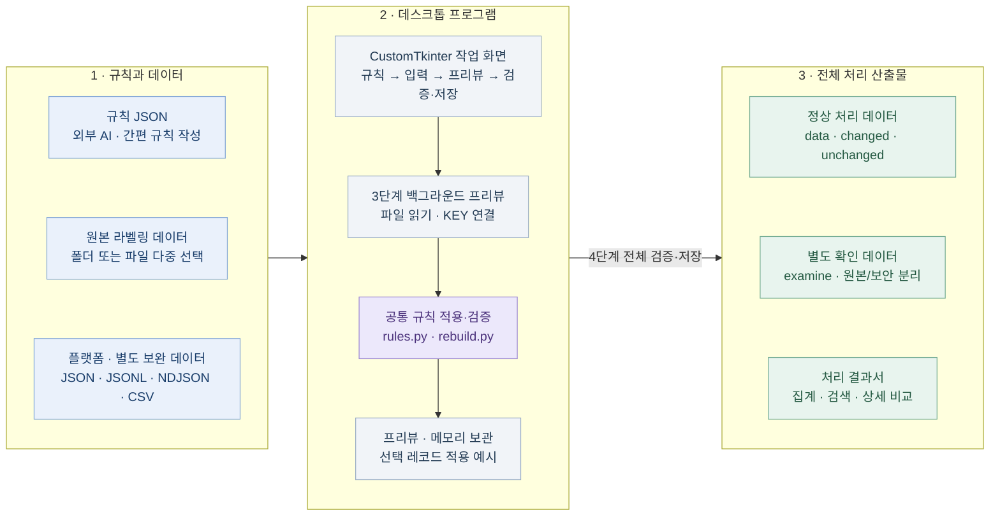
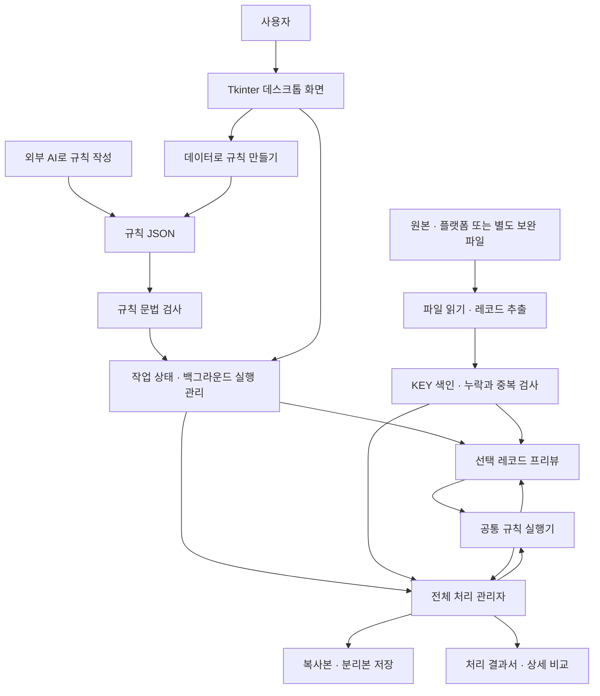
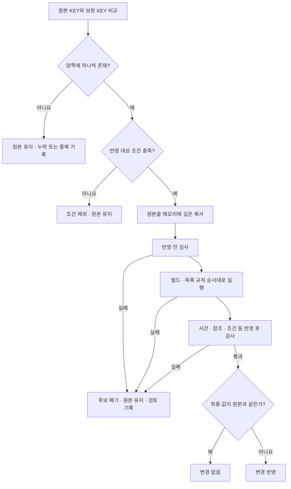

# 라벨 포터 아키텍처와 규칙 엔진



규칙과 입력을 KEY로 연결한 뒤 **선택 레코드의 적용 예시를 계산**합니다. 읽기·계산 중에는 4단계 이동을 잠급니다. 4단계에서 전체 검증과 보고서 확인 후 복사본을 저장합니다. 위 도식은 프로그램 안에서도 오프라인으로 표시됩니다.

기준: **v2.26.0 · schema_version 1 · 2026-10-22**

현재 저장소의 실제 구현을 기준으로 작성했습니다.

이 문서는 프로그램의 **사용 방법 → 아키텍처 · 규칙 엔진** 탭에서도 볼 수 있습니다. 목차·검색·글자 크기를 조절할 수 있으며, ‘작업으로 돌아가기’를 누르면 이전 단계와 프리뷰가 유지됩니다.

### 클라이언트 화면 구성

v2.24.0부터 CustomTkinter로 메인 창·JSON 뷰어 창, 버튼, 입력창, 선택 메뉴, 체크박스, 스크롤바, 진행 막대, 카드와 탭 버튼을 구성합니다. `label_porter/widgets.py`가 공통 색상·크기·키보드 동작과 기존 화면의 위젯 인터페이스를 연결합니다. 실제 탭의 선택·숨김·페이지 관리는 기존 Notebook 동작을 유지합니다.

v2.24.2에서는 `smooth_surface.py`가 버튼·입력창·드롭다운·카드의 모서리를 안티앨리어싱하고, `WrapBar`가 좁은 화면의 버튼을 줄바꿈합니다. 문서의 Mermaid는 내장 PNG를 표시 크기로 고품질 축소한 뒤 Tk 이미지 위젯으로 삽입해 HTML 뷰어의 재축소를 피합니다. 현재 표시 이미지와 원본 PNG 바이트만 보관하며 도움말을 닫을 때 해제합니다.

대량 목록을 표시하는 Treeview, JSON 텍스트 영역, 연결선 Canvas와 구조용 컨테이너는 Tk/ttk를 함께 사용합니다. 문서는 기존 tkinterweb, Mermaid는 내장 이미지로 표시합니다. 처리 엔진·규칙 문법·원본 보존·examine·보고서 저장 방식은 화면 라이브러리와 분리되어 있습니다.

화면을 닫을 때 CustomTkinter의 변수 추적, 드롭다운 DPI 콜백, 클릭 애니메이션과 창 예약 작업을 정리합니다. 입력 검사와 JSON 처리의 백그라운드 작업, 프리뷰 세션·검색 색인 정책은 유지합니다.

### 파일과 코드의 명칭

| 이름 | 용도 |
| --- | --- |
| `rules/` | 프로그램에 포함하는 규칙 JSON 예제 폴더 |
| `local_rules/` | 개인 작업 규칙 보관 위치. Git에서 제외 |
| `project_rule.json` | 규칙 내보내기의 기본 파일명. AI에게 요청할 권장 파일명 |
| `rule.json` | 실행 결과 폴더에 보관하는 실제 적용 규칙 |
| `label_porter/rules.py` | 규칙을 해석·실행하는 Python 코드. JSON 예제 폴더와 역할이 다름 |

규칙 JSON 내부의 `schema_version`, `source`, `result`, `rules` 문법은 유지합니다. 이름을 바꾸기 위해 기존 규칙 내용을 변환할 필요가 없습니다. 이전 파일명으로 된 규칙도 불러올 수 있고 기존 결과 폴더도 그대로 확인할 수 있습니다. 새 결과 요약은 적용 규칙 이름을 `rule` 항목에 기록합니다.

## 1. 규칙 JSON을 누가 실행하나요?

**프로그램 안에 자체 규칙 해석·실행 엔진이 있습니다.** 규칙 JSON은 이 엔진에 전달하는 작업 명세입니다. AI가 작성한 문장을 실행하는 방식이 아니라, 프로그램이 미리 지원하는 명령과 필드만 해석합니다.

예를 들어 규칙에 “같은 `sound_id`끼리 연결하고 보완본의 어절 목록을 원본의 `/Segmentation/eojeols`에 넣는다”는 구조가 있으면, Python 코드가 연결키를 비교하고 목록을 복사하며 검증과 저장을 수행합니다.

| 구분 | 역할 | 실제 구현 |
| --- | --- | --- |
| 규칙 파일 | 어떤 데이터를 연결하고 무엇을 바꿀지 선언 | `project_rule.json` 등 |
| JSON 해석기 | JSON 텍스트를 객체·배열·숫자 등으로 읽음 | Python JSON 기능 + [formats.py](label_porter/formats.py), [stream_json.py](label_porter/stream_json.py) |
| 규칙 문법 검사기 | 지원하는 항목, 경로, 연산, 자료형인지 확인 | [config.py](label_porter/config.py) |
| 규칙 실행기 | 값을 읽고 변환하고 원본 복사본에 반영 | [rules.py](label_porter/rules.py), [rebuild.py](label_porter/rebuild.py) |
| 전체 처리 관리자 | 파일 읽기, KEY 연결, 저장, 오류 분리, 보고서 생성 | [engine.py](label_porter/engine.py) |

AI는 **규칙을 작성하는 외부 도구**입니다. 라벨 포터 자체에는 AI API 호출, 플랫폼 DB 연결, 자연어 해석 기능이 없습니다. 프로그램의 ‘데이터로 규칙 만들기’도 로컬 데이터를 분석하여 같은 규칙 JSON을 생성합니다.

새로운 명령 이름을 JSON에 적는 것만으로 기능이 추가되지는 않습니다. 지원하지 않는 명령은 문법 검사에서 거절되며, 새로운 처리 알고리즘은 프로그램 코드에 구현해야 합니다.

## 2. 전체 구조

**규칙 준비 → 입력 읽기 → KEY 연결 → 규칙 실행 → 검증 → 복사본·검토 자료·보고서 저장**

| 계층 | 들어오는 것 | 담당 역할 | 다음 단계로 전달 |
| --- | --- | --- | --- |
| 화면 | 규칙 파일, 원본·보완 선택 | 규칙 작성·확인, 작업 단계·진행률 관리 | 규칙과 입력 위치 |
| 입력 | JSON·JSONL·NDJSON·CSV | 문서 해석, 레코드 추출, KEY 색인 | 연결된 원본·보완 한 쌍 |
| 실행 | 한 쌍과 규칙 | 값 읽기·변환·필드 반영·목록 재구성 | 적용 후보와 변경 근거 |
| 검증 | 적용 후보 | 조건·시간·참조 검사 | 반영 가능 또는 원본 유지 판정 |
| 출력 | 판정된 모든 레코드 | 복사본·분류별 원본/보안·처리 결과서 작성 | 검수와 재처리에 사용할 파일 |

3단계는 입력을 읽고 선택 레코드의 적용 예시만 계산합니다. 전체 검증과 파일 출력은 4단계에서 각각 실행합니다.

사용 방법 화면에서는 최상단의 Mermaid 구조도와 위 표를 함께 확인할 수 있습니다. 문서 맨 아래 부록의 상세 연결 구조도와 레코드 처리 흐름도도 프로그램 안에서 그림으로 표시됩니다.

GUI 3단계는 `pair_preview.load_preview()`로 입력·KEY 목록을 읽고 `catalog_preview()`와 `apply_record()`로 선택 레코드만 계산합니다. 4단계는 `engine.run(preview=True)`로 전체 검증하고, 저장 시 `engine.run(preview=False)`를 실행합니다. 3단계에서 전체 처리 엔진이나 임시 완성본 저장 경로를 호출하지 않습니다.

## 3. 사용 화면과 작업 상태

기본 작업 순서는 **규칙 준비 → 입력 데이터와 저장 위치 → 연결·전체 처리 → 결과 확인·저장**입니다.

| 화면 또는 기능 | 담당 코드 | 역할 |
| --- | --- | --- |
| 전체 화면과 단계 이동 | [gui.py](label_porter/gui.py) | 프로젝트 규칙, 입력, 연결 확인, 처리 단계 구성 |
| 작업 상태와 실행 제어 | [workflow.py](label_porter/workflow.py) | 입력·규칙 기억, 검증 상태, 진행률·중단, 작업 스레드와 화면 연결 |
| 검증과 최종 저장 | [workflow.py](label_porter/workflow.py), [engine.py](label_porter/engine.py) | 백그라운드 입력 검사, 전체 검증 보고서, 최종 복사본 저장 |
| 양쪽 입력 선택 | [data_input_ui.py](label_porter/data_input_ui.py) | 원본과 보완 모두 폴더 또는 파일 다중 선택, JSON 미리보기 |
| 규칙 구조 표시 | [rule_review.py](label_porter/rule_review.py) | 필드 연결과 규칙 JSON을 읽기 전용으로 표시 |
| 실제 데이터 프리뷰 | [pair_preview.py](label_porter/pair_preview.py), [pair_preview_ui.py](label_porter/pair_preview_ui.py) | 전체 레코드 목록·검색·페이지 이동, 실제 값 연결과 적용 후 JSON |
| 간편 규칙 작성 | [easy_rules.py](label_porter/easy_rules.py), [easy_rules_ui.py](label_porter/easy_rules_ui.py) | KEY 추천·직접 선택, 반영 필드 연결, 규칙 생성 |
| JSON 파일 뷰어 | [file_browser.py](label_porter/file_browser.py), [json_viewer.py](label_porter/json_viewer.py), [json_search.py](label_porter/json_search.py) | 폴더 트리·파일 검색·페이지 이동, 선택 파일과 JSON 동기화, 중첩 배열의 키·값 검색과 결과 경로 이동 |
| 문서 뷰어 | [markdown_viewer.py](label_porter/markdown_viewer.py) | 작성 가이드·사용 방법·지원 범위·아키텍처 4개 탭. Markdown 제목·표·코드·내장 Mermaid 도식, 목차·검색·글자 크기·도식 확대 |

읽은 프리뷰 데이터와 검색·선택 상태는 같은 실행 세션에서 재사용합니다. 최근 선택한 레코드의 계산 결과도 최대 16개 보관합니다. 규칙이나 입력 선택을 바꾸면 기존 세션을 해제하며, 같은 파일을 외부에서 수정했다면 2단계에서 해당 입력을 다시 선택해야 합니다.

단계 이동으로 화면을 숨기는 동안에는 세션을 유지합니다. 화면을 실제로 닫거나 교체하면 해당 화면의 검색 콜백·예약 작업·대기 큐·데이터 참조를 해제합니다. 백그라운드 작업은 중단 신호를 받고, 늦게 완료되더라도 닫힌 큐가 결과를 버립니다. 이 수명 관리는 `ui_lifecycle.py`와 각 화면의 종료 처리에서 담당하며 규칙 실행 결과에는 영향을 주지 않습니다.

프로그램을 종료하면 메모리의 프리뷰 세션은 사라집니다. 규칙·입력 위치 등 설정은 `%APPDATA%/LabelPorter/settings.json`에 저장합니다. 3단계의 완성본 임시 저장은 사용하지 않습니다. 내용 검색 시 필요한 색인만 임시 파일로 보관합니다.

### 화면 응답성과 대형 입력 처리 (2.22)

| 처리 | 실행 위치·보관 방식 | 유지하는 기준 |
| --- | --- | --- |
| 파일 목록·변경 여부 확인 | `input_check.py`가 화면에서 캡처한 입력으로 백그라운드 검사 | 복사본 저장 직전 규칙·원본·보완·보조 파일의 경로/크기/수정 시각 재확인 |
| 프리뷰 재방문 | 기존 세션을 즉시 표시 | 외부 수정 반영은 2단계 입력 재선택, 저장 전에는 새 검사 |
| JSON 읽기 | `stream_json.py`: 배열을 나누어 읽고 짧은 필드 이름을 읽기 단위로 공유 | 중복 키·비정상 숫자 거절, 인코딩·원문 해시 유지 |
| 긴 값 표시 | `json_display.py`: 표시 한도까지 직렬화 | 원문·실제 출력은 자르지 않음 |
| 내용 검색 | `search_index.py`의 지연 색인을 처음 필요할 때 생성 | 대소문자 무시·부분 문자열·복수 검색어·검색 범위 기준 유지 |
| 일반 레코드 상세 | `detail_store.py`에 근거를 묶어 저장하고 `detail_renderer.py`로 열람 시 구성 | 전체 JSONL 보관, 큰 정수·소수 표기 보존, 오프라인 동작 |

입력 데이터와 KEY 목록은 메모리에 보관하고, 선택한 레코드의 적용 결과는 최근 16건만 재사용합니다. 전체 입력을 읽으므로 메모리 사용량은 데이터 크기에 비례합니다. JSON 내용 검색을 요청한 경우에만 검색용 임시 파일을 만들며 최종 출력과 보고서는 3단계에서 만들지 않습니다.

## 4. 규칙 JSON의 구조

현재 지원 문법은 **schema_version 1**입니다. 이 번호는 프로그램 버전 `2.26.0`과 별개입니다.

| 최상위 항목 | 필수 | 의미 |
| --- | --- | --- |
| `schema_version` | 예 | 규칙 문법 버전. 현재 정수 `1` |
| `name` | 예 | 규칙 이름 |
| `description` | 아니요 | 규칙 설명 |
| `source` | 예 | 원본 레코드 위치, KEY, 파일 선택 패턴 등 |
| `result` | 예 | 보완 레코드 위치, KEY, 입력 형식 등 |
| `include_when` | 아니요 | 이 레코드를 반영 대상으로 포함할 조건 |
| `checks` | 아니요 | 반영 전 확인할 조건 |
| `rules` | 예 | 순서대로 실행할 수정 규칙 |
| `assertions` | 아니요 | 반영 후 후보 레코드의 검사 |

`source`와 `result`의 `records_path`는 파일 안에서 레코드가 모여 있는 위치입니다. `record_mode`는 `auto`, `object`, `array` 중 하나이고, `key`는 각 레코드를 연결하는 값을 읽는 규칙입니다.

예를 들어 파일이 `{"records":[{"sound_id":"s1"}]}`이면 `records_path`는 `/records`, 레코드의 KEY는 `/sound_id`입니다. 이후 필드 경로는 파일 맨 위가 아니라 **선택된 레코드 안**을 기준으로 읽습니다.

경로는 JSON Pointer 형식입니다. `/Segmentation/eojeols/9/end`는 0부터 세어 10번째 어절의 `end`입니다. `/`를 포함한 키는 `~1`, `~`는 `~0`으로 씁니다. JSONPath의 `$`, `[*]`를 실행 경로로 사용하지 않습니다.

### 그대로 사용할 수 있는 작은 문법 예제

다음 예제는 **원본과 보완 데이터가 같은 필드 구조**라는 가정입니다. 같은 `sound_id`끼리 연결하여 어절 목록과 전사를 교체하고, 다른 메타데이터와 독립된 발음 오류 태그는 건드리지 않습니다. 실제 프로젝트 적용 전에는 데이터 구조와 정책을 확인해야 합니다.

```json
{
  "schema_version": 1,
  "name": "같은 구조의 어절·전사 반영 예제",
  "source": {
    "records_path": "",
    "record_mode": "auto",
    "key": "/sound_id",
    "glob": "**/*.json"
  },
  "result": {
    "records_path": "",
    "record_mode": "auto",
    "key": "/sound_id"
  },
  "rules": [
    {
      "kind": "field",
      "from": "/Segmentation/eojeols",
      "to": "/Segmentation/eojeols",
      "type": "array",
      "allow_container_replace": true
    },
    {
      "kind": "field",
      "from": "/RecordingMetadata/orthographic",
      "to": "/RecordingMetadata/orthographic",
      "type": "string"
    }
  ],
  "assertions": [
    {
      "kind": "intervals",
      "path": "/Segmentation/eojeols",
      "start": "/start",
      "end": "/end",
      "ordered": true
    }
  ]
}
```

이 예제는 어절 개수와 텍스트가 달라도 보완 목록 전체를 반영합니다. 반올림은 지정하지 않았습니다. 입력 숫자 `1.20000`은 저장할 때 `1.2`처럼 표시될 수 있지만, 소수 자릿수를 일정하게 줄이는 규칙을 자동 적용하지는 않습니다.

플랫폼의 어절 구조가 `value.startTime`, `value.endTime` 등으로 다르면 해당 경로를 읽어 원본 구조로 만드는 `rebuild_items`를 사용할 수 있습니다. 문법 전체와 다양한 예제는 [AI 규칙 작성 가이드](AI_규칙작성_가이드.md)를 참고하세요.

### 값 읽기와 변환

`from: "/text"`는 보완 레코드 또는 현재 보완 목록 항목의 `/text`를 읽는 축약형입니다. 객체 형태로 쓰면 읽기 범위와 변환을 지정할 수 있습니다.

| 읽기 범위 `scope` | 의미 |
| --- | --- |
| `result` | 현재 보완 레코드 또는 목록 항목. 기본값 |
| `source` | 현재 수정 중인 원본 복사본 또는 목록 항목 |
| `original` | 수정 전 원본 레코드 또는 목록 항목 |
| `root_result` | 현재 보완 레코드 전체 |
| `root_source` | 수정 중인 원본 레코드 전체 |
| `root_original` | 수정 전 원본 레코드 전체 |

목록을 새로 만드는 `rebuild_items`의 내부에서는 `source`가 새 객체이며 `original`은 빈 객체입니다. 이때 전체 원본이 필요하면 `root_original`을 사용합니다. 프리뷰에 보여주는 기존 항목의 비교값은 이 실행 범위와 별개입니다.

값은 `path`로 읽거나 `literal` 상수, `meta` 파일명·상대 경로·결과 행 번호·항목 순번에서 가져올 수 있습니다. 이후 `transforms`를 적힌 순서대로 실행합니다.

지원 변환은 `strip`, `string`, `integer`, `number`, `basename`, `parse_json`, `length`, `regex`, `scale`, `offset`, `round`, `pluck`, `join`, `map_values`입니다. `round`는 규칙이 명시한 경우에만 실행합니다. 지원하지 않는 수식이나 임의 Python·JavaScript를 JSON 안에 넣어 실행할 수는 없습니다.

### 목록을 다루는 세 가지 방법

| 규칙 | 처리 방식 | 선택할 상황 |
| --- | --- | --- |
| `field` + `allow_container_replace: true` | 배열·객체를 보완값 그대로 교체 | 양쪽 목표 구조가 같고 추가 필드까지 전체 반영할 때 |
| `items` | 기존 항목과 보완 항목을 ID로 연결해 내부 필드를 수정 | 항목 정체성과 기존 구조를 유지하면서 특정 값만 바꿀 때 |
| `rebuild_items` | 보완 목록의 각 항목에서 지정 필드를 읽어 새 목록 생성 | 개수 변경·분할·병합 반영, 플랫폼 구조 변환, 정렬·ID 재구성이 필요할 때 |

`items`는 새 ID를 임의로 추가하지 않습니다. `require_same_keys: false`라면 보완 결과에 없는 기존 항목을 유지할 수 있습니다. 반면 `rebuild_items`는 보완 목록의 개수로 전체 목록을 다시 만듭니다. 내부 규칙에 쓰지 않은 항목 필드는 자동으로 따라오지 않으므로 필요한 필드를 모두 선언해야 합니다.

`rebuild_items.references`를 명시하면 기존 태그의 참조를 연결하는 별도 처리를 수행합니다. 이 설정이 없으면 세그멘테이션 밖의 독립 태그를 자동 삭제하거나 재연결하지 않습니다.

## 5. 한 레코드가 처리되는 순서

| 순서 | 확인 또는 처리 | 통과하지 못하면 |
| --- | --- | --- |
| 1 | 원본 KEY와 보완 KEY가 양쪽에 하나씩 있는지 확인 | 누락·중복으로 기록, 임의 연결 안 함 |
| 2 | 레코드 반영 대상 조건 확인 | 조건 제외, 원본 유지 |
| 3 | 원본의 메모리 복사본에 반영 전 검사 수행 | 검토 보류, 원본 유지 |
| 4 | 필드·목록 규칙을 순서대로 실행 | 레코드 변경 전체 취소 |
| 5 | 시간·참조·조건 등 반영 후 검사 | 레코드 변경 전체 취소 |
| 6 | 최종 값과 원본 비교 | 같으면 변경 없음, 다르면 변경 반영 |

실제 코드에서는 복사본을 먼저 만들고 조건을 평가합니다. 표는 처리 판단의 흐름을 보여 줍니다.

KEY는 단순 문자열로 강제 변환하지 않습니다. 예를 들어 문자열 `"1"`과 숫자 `1`은 다릅니다. 같은 의미로 연결해야 한다면 규칙에서 `string` 또는 `integer` 등의 변환을 명시합니다. 중복 KEY를 첫 번째 행이나 최신 행으로 추정하지 않습니다.

한 레코드의 규칙 중 하나라도 실패하면 그 레코드의 변경 전체를 폐기합니다. 다른 정상 레코드는 계속 처리할 수 있습니다. `when`은 해당 규칙만 건너뛰고, `include_when`은 레코드 전체를 제외합니다. `checks`와 `assertions` 실패는 검토 대상으로 처리합니다.

검사는 규칙에 선언된 범위에서 수행합니다. 지원 검사에는 일반 조건, 시간 구간의 음수·역전·길이 초과·순서·겹침, 참조 대상 ID와 태그의 연결 등이 있습니다. 모든 도메인의 정답 여부를 자동 판단하는 기능은 아닙니다.

## 6. 프리뷰와 전체 검증·저장

| 단계 | 하는 일 | 완료 조건 |
| --- | --- | --- |
| 3. 필드 연결·프리뷰 | 전체 입력 읽기·KEY 목록 구성, 선택 레코드 적용 결과 계산 | 읽기·계산이 끝나야 다음 단계와 4단계 메뉴 활성화 |
| 3. 검색·페이지·선택 | 읽은 입력 재사용, 새 선택의 적용 결과 계산 | 계산 중 이동 잠금, 최근 16건 재사용 |
| 4. 전체 데이터 검증 | 전체 레코드 검증, `미리보기/reports` 보고서 생성 | 검증 완료 후 복사본 저장 활성화 |
| 4. 복사본 저장 | 입력 변경 검사 후 전체 규칙 실행·최종 데이터·examine·보고서 저장 | 날짜/순번 폴더에 완료 상태 기록 |

프리뷰 중 중단·실패하면 다음 단계로 이동하지 못하며 다시 불러와야 합니다. 검토 필요·짝 없음 등 개별 레코드의 판정은 전체 검증 단계로 이동하는 것을 막지 않습니다. 입력·규칙 변경은 캐시를 해제하며 저장 위치만 변경하면 프리뷰 입력은 유지하고 전체 검증을 다시 요구합니다.

전체 검증 전후 입력 파일 목록·크기·수정 시각을 확인하고 저장 직전에 다시 비교합니다. 변경이 발견되면 전체 검증을 다시 요청합니다. 저장 중단·실패는 결과서에 미완료로 표시합니다. 3단계의 임시 완성본 생성과 전체 산출물 재읽기·해시 확인은 실행하지 않습니다.

CLI `run`과 `--preview`의 동작은 유지합니다.

## 7. 파일 읽기와 대용량 처리

[input_files.py](label_porter/input_files.py)가 선택 파일, 폴더, 상대 경로를 정리합니다. 원본은 JSON·JSONL·NDJSON, 보완은 이들 형식과 CSV를 지원합니다. 통합 배열이나 중첩 레코드도 규칙의 위치를 기준으로 추출합니다. CSV 안의 JSON 문자열 열은 `csv_json_columns`로 명시합니다.

폴더를 원본으로 선택하면 라벨 선택에는 `source.glob`을 쓰고, 저장 시 폴더 안의 기타 파일도 전체 복사본에 보존합니다. 파일을 직접 다중 선택하면 선택한 파일만 처리·복사합니다. 보완 폴더 선택은 지원 형식 파일을 찾아 입력 목록으로 만듭니다.

| 최적화 | 실제 동작과 범위 |
| --- | --- |
| JSON 분할 읽기 | 진행률·중단을 사용하는 읽기 경로는 약 256 KiB 단위로 해석. 큰 텍스트를 한 번에 읽는 부담을 줄임 |
| 백그라운드 작업 | 읽기·분석·전체 처리를 화면 이벤트 처리와 분리하고 큐로 상태 전달 |
| KEY 색인 | 원본마다 전체 보완 파일을 다시 탐색하지 않고 KEY로 접근 |
| 프리뷰 세션 | 읽은 데이터를 재사용하고 최근 레코드 결과를 보관 |
| 파일 뷰어 | 폴더·파일 선택은 같은 입력 교체 경로를 사용. 파일 100개와 그 상위 폴더를 트리로 표시하고 선택 파일만 해석. 새 입력은 이전 읽기·검색 세대를 무효화 |
| JSON 내부 검색 | 현재 문서를 백그라운드에서 순회하며 키·스칼라 값을 검색. 직렬화한 전체 문자열 캐시 없이 일치 경로만 보관. 결과 100개씩 표시하며 먼 배열 항목도 앞 항목 전체를 만들지 않고 이동. 파일 변경·창 닫기 시 취소 |
| 보고서 상세 분할 | 상세 데이터를 여러 묶음으로 저장하고 필요한 묶음을 로드 |

현재 전체 레코드와 KEY 색인은 메모리에 보관합니다. **분할 읽기를 사용해도 메모리 사용량이 입력 크기와 무관해지는 구조는 아닙니다.** CSV 등 일부 읽기 경로는 전체 파일을 읽습니다. 수백 GB 규모를 일정 메모리로 처리하는 디스크 색인·외부 정렬·분산 실행 기능은 없습니다.

프리뷰 연결 표시는 한 레코드당 최대 200행, JSON 화면도 표시 길이 제한이 있습니다. 이는 화면 표시 한도이며 실제 처리 대상 레코드나 필드 수 제한은 아닙니다.

## 8. 저장·examine·처리 결과서

저장 위치를 지정하지 않으면 실행 파일 옆 `results`를 사용합니다. 사용자가 선택한 경로에는 `포팅결과`를 붙이지 않습니다. 해당 경로 아래에서 미리보기 또는 한국 날짜·실행 순번을 관리합니다.

```text
선택한 저장 위치/
├─ 미리보기/                      # 최신 전체 검증 보고서
└─ YYYY-MM-DD/001/                # 실제 저장 1회
   ├─ data/                      # 원본 구조를 유지한 전체 처리 복사본
   ├─ changed/labels/            # 정상 변경 레코드
   ├─ unchanged/labels/          # 정상 미변경 레코드
   ├─ examine/
   │  ├─ unmatched/              # 원본 또는 보완 짝이 없음
   │  ├─ review/                 # 규칙 검토·KEY 오류·중복·추가 검토
   │  ├─ excluded/               # 반영 대상 조건에서 제외
   │  └─ file_errors/            # 읽기·해석 등 파일 단위 문제
   ├─ reports/
   │  ├─ report.html             # 검색·필터·페이지 이동이 있는 결과서
   │  ├─ detail.html             # 공통 상세 비교 화면
   │  ├─ detail_data/            # 상세 화면에서 읽는 데이터 묶음
   │  ├─ catalog.json            # 분류별 목록
   │  ├─ records.csv             # 상태·연결·검토 사유
   │  ├─ changes.jsonl           # 변경 경로와 전후 값
   │  ├─ record_details.jsonl    # 처리 항목 상세
   │  ├─ review_details.jsonl    # 검토 사유와 원본·보완·출력·후보
   │  ├─ partition_index.jsonl   # 입력과 분리 파일의 대응
   │  └─ summary.json            # 처리 집계
   ├─ rule.json               # 실제 적용 규칙
   ├─ manifest.json              # 입력·출력 파일과 해시
   └─ run_status.json            # 완료·실패·중단 상태
```

실제 저장 시 examine의 각 분류 안에 **원본은 `원본`, 보완은 `보안`** 폴더에 나누어 저장합니다. 개별 파일은 이름·하위 경로·입력 바이트를 그대로 유지하고, 통합 파일은 해당 파일명 아래 건별 파일로 분리합니다. 누락된 쪽의 대체 파일은 만들지 않습니다. 통합 JSON은 해당 레코드만 추출하되 배열·객체의 바깥 구조와 메타데이터를 유지합니다. 읽을 수 없어 레코드 추출 자체가 불가능한 파일 오류는 파일 전체를 `file_errors/원본` 또는 `file_errors/보안`에 보관합니다. 정상 변경·미변경 분리를 꺼도 examine은 저장합니다.

`data`에는 검토로 보류한 레코드도 원본 값 그대로 남습니다. examine의 `원본`은 처리 전 원본입니다. 일부 정상 반영과 추가 검토가 함께 발생한 레코드라면 실제 출력은 `data`와 보고서에서 확인합니다.

GUI 전체 검증과 CLI `--preview`에서는 실제 데이터·examine 파일을 쓰지 않고 보고서와 분리 예정 내역을 작성합니다. 실제 저장 중 중단·파일 오류가 발생하면 부분 결과가 남을 수 있습니다. 레코드 내부 변경은 전체 적용 또는 전체 취소지만 작업 폴더 전체를 한 번에 취소하는 트랜잭션은 아닙니다.

| 책임 | 담당 코드 |
| --- | --- |
| 날짜·순번·미리보기 잠금과 출력 경로 | [storage.py](label_porter/storage.py) |
| 변경·미변경·검토 분리와 원본 형태 추출 | [partitions.py](label_porter/partitions.py), [examine.py](label_porter/examine.py) |
| 검토 사유와 문제 위치·값 수집 | [diagnostics.py](label_porter/diagnostics.py) |
| 집계·CSV·JSONL 보고서 | [reports.py](label_porter/reports.py) |
| 결과서·검색·페이지 이동 | [result_dashboard.py](label_porter/result_dashboard.py), [report_paging.py](label_porter/report_paging.py) |
| 상세 비교와 상세 데이터 분할 | [detail_store.py](label_porter/detail_store.py), [review_report.py](label_porter/review_report.py) |

보고서는 로컬 HTML·JavaScript로 동작하며 서버가 필요하지 않습니다. 상세 데이터 파일을 함께 사용하므로 이동할 때는 `report.html`만이 아니라 **reports 폴더 전체**를 옮겨야 합니다.


### 보고서 숫자를 읽는 기준

보고서의 모든 카드는 같은 대상을 나누어 센 값이 아닙니다. 원본·보완은 서로 다른 입력이며, 변경 필드는 필드 경로 수, 파일 오류는 파일 수입니다. 검토/오류 목록에는 양쪽 입력의 검토와 파일 오류가 포함되어 다른 카드와 겹칠 수 있습니다.

예를 들어 테스트 원본 20건이 **검증 통과 5 + 검토 보류 5 + 조건 제외 5 + 보완 짝 없음 5**로 나뉘어도, 원본 없는 보완 5건과 양쪽 파일 오류 10개가 있으면 검토/오류 목록은 20행일 수 있습니다. 해석 불가능한 파일은 레코드 개수를 알 수 없어 원본·보완 레코드 수에 포함하지 않습니다.

원본 자체의 처리 합계는 `source_status_counts`, 보완 입력의 문제는 `result_issue_counts`, 원본 파일 문제는 `source_file_issue_counts`를 확인합니다. `examine_category_counts`는 네 저장 분류의 건수이고, `partition_records`는 원본 레코드가 변경·미변경·검토로 나뉜 건수입니다. 개별 파일 수·레코드 수·검토 사유 수를 서로 합산하지 않습니다.

## 9. 실행·배포·검증

- **데스크톱 실행:** [launcher.py](launcher.py)가 Tkinter 앱을 시작합니다. [LabelPorter.spec](LabelPorter.spec)으로 Python 실행 환경·문서 뷰어·가이드·규칙 예제를 단일 EXE에 묶습니다.
- **소스·명령행 실행:** [__main__.py](label_porter/__main__.py)는 GUI, `validate-config`, `run`을 제공합니다. CLI와 GUI 모두 같은 규칙·처리 엔진을 사용합니다.
- **자동 검사:** [tests](tests)에서 입력·규칙·원본 보존·프리뷰·UI·보고서·분리 저장을 검증합니다. 일부 보고서 JavaScript 검사는 Node.js를 사용하지만 프로그램 실행에는 필요하지 않습니다.
- **배포 파일 검사:** EXE의 `--self-test`로 내장 문서·Tk 화면·프리뷰·규칙 실행·저장을 임시 데이터로 확인합니다.
- **저장 결과 독립 확인:** [scripts/verify_run.py](scripts/verify_run.py)로 입력 해시, 복사본 보존, 보고서에 기록한 변경과 실제 출력의 일치를 확인할 수 있습니다.

### GitHub 릴리스와 프로그램 업데이트

라벨 처리 엔진과 별도로 동작합니다. 기능 수정·커밋만으로 버전을 바꾸지 않으며 [scripts/release.py](scripts/release.py)의 `prepare --version` → 검토·커밋 → `build` → `publish` 순서로 배포합니다. 빌드는 Git 커밋의 스냅샷만 사용합니다. 게시 단계에서 main과 버전 태그를 push하고, 비공개 GitHub Release 초안에 ZIP·체크섬 명세를 올린 뒤 정식 게시합니다.

| 구성 | 책임 |
| --- | --- |
| `update_ui.py` | 기존 작업 화면을 유지하는 업데이트 페이지, 백그라운드 확인·다운로드, 처리 중 설치 차단 |
| `update_service.py` | 저장소 접근 인증, 최신 정식 릴리스 비교, 다운로드 크기·SHA-256·압축 경로 검사 |
| `update_install.py` | 별도 프로세스에서 기존 앱 종료 대기, 실행 파일·배포 문서 교체, 백업·실패 복구·재시작 |
| `scripts/release.py` | 명시적 버전 갱신, 커밋 소스의 검사·빌드·패키징, Git 태그와 GitHub 릴리스 게시 |

인증 정보는 배포 파일에 포함하지 않습니다. 사용자 토큰은 Windows DPAPI로 보호 저장하거나 PC의 Git 인증을 이용합니다. 다운로드 리디렉션은 GitHub 배포 호스트로 제한하고 외부 다운로드 호스트에는 인증 헤더를 전달하지 않습니다. 캐시·백업·설치 결과는 `%LOCALAPPDATA%/LabelPorter/updates`에 보관합니다. 실제 라벨 데이터나 처리 결과 폴더는 업데이트 대상이 아닙니다. 현재 작업 설정은 저장하며 메모리 프리뷰·검증 세션은 재시작 후 다시 구성합니다.

## 10. 기능을 확장할 때 바꿀 곳

| 추가하려는 기능 | 주요 변경 지점 |
| --- | --- |
| 새 플랫폼의 필드명이 다름 | 기존 연산으로 표현되면 새 규칙 JSON만 작성 |
| 새로운 값 변환 | `config.py`의 허용 문법 + `rules.py`의 실행 구현 |
| 새로운 목록 처리 방식 | `config.py`, `rules.py` 또는 `rebuild.py`, 프리뷰·진단 연동 |
| 새 파일 형식 | `formats.py`, 입력 파일 탐색, 원본 형태 분리·저장 구현 |
| 새로운 검토 사유·보고서 속성 | `diagnostics.py`, `engine.py`, `reports.py`, 결과서·examine 분류 |
| 큰 데이터를 메모리 사용량 제한 아래 처리 | 입력 읽기뿐 아니라 KEY 색인·프리뷰 세션·보고서 저장 구조까지 변경 |

새 문법을 추가하면 규칙 작성 가이드, 문법 오류 검사, 실제 실행, 프리뷰와 출력의 일치, 원본 보존 검사를 함께 갱신해야 합니다.

이미지·오디오·3D·LLM 데이터도 JSON의 연결키와 목표 필드가 명확하고 지원 연산으로 표현할 수 있으면 후처리할 수 있습니다. 이미지에서 라벨 생성, 음성 재전사, 3D 좌표계 변환 알고리즘, 문장 품질 판단처럼 별도 분석이 필요한 작업은 현재 규칙 엔진만으로 수행하지 않습니다. 업무별 범위는 [후처리 지원 범위](후처리_지원범위.md)에 정리되어 있습니다.


## 부록. 개발용 연결 구조도

아래 Mermaid 도식도 프로그램의 문서 뷰어에서 그림으로 표시됩니다. 뷰어 상단의 **도식**에서 화면 맞춤 또는 100/150/200% 확대를 선택할 수 있습니다. 원문 MD의 Mermaid 코드를 기준으로 도식을 생성하여 앱에 포함하므로 인터넷 연결이 필요하지 않습니다.

### 전체 구성



### 레코드 처리


